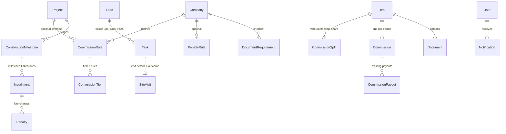

# Phase 2 design: data model, screens, API, rules

Scope (spec section 10): pipeline board, site visits and tasks, commission engine, documents and checklists, Inventory and Sales Team dashboards, Agent "My Day", notifications. Also moved here from Phase 1: milestone-based payment schedules and optional late penalties.

Out of scope (Phase 3): contract templates, client portal, SMS/Telegram, full Amharic translation.

Status key: **New** = new table/screen · **Change** = existing one extended.

## 1. Data model changes

| Table | Status | Key fields | Notes |
|---|---|---|---|
| `Task` | New (replaces `FollowUp`) | companyId, leadId, assigneeId, type (CALL / MESSAGE / SITE_VISIT / MEETING / OTHER), dueAt, doneAt, outcome | Existing follow-ups migrate into tasks. Overdue = not done and dueAt < now. |
| `SiteVisit` | New | taskId, projectId, unitIds[], scheduledAt, attended, outcome (INTERESTED / NOT_INTERESTED / NEEDS_TIME / NO_SHOW), note | Completing a visit auto-creates a follow-up task (company `followUpDays`). |
| `Lead.stage` | Change | reuse `LeadStatus` (New → Contacted → Site visit → Negotiation → Won / Lost) | Kanban columns. Moving to Lost needs a reason. Won only via a sale. |
| `CommissionRule` | New | companyId, projectId?, type (PERCENT / FIXED / TIERED), rate, fixedAmount, payableAfterPct, appliesTo (INTERNAL / EXTERNAL / ALL), activeFrom | Project rule overrides company rule. Replaces `Project.commissionRate`. |
| `CommissionTier` | New | ruleId, fromAmount, toAmount?, rate | For TIERED. |
| `CommissionSplit` | New | dealId, userId, sharePct | Sum = 100%. Default: 100% to the deal's agent. |
| `Commission` | New | companyId, dealId, userId, ruleSnapshot (JSON), amount, status (CALCULATED / APPROVED / PAID / CANCELLED), approvedBy/At, paidBy/At, reference | Rule is snapshotted on the sale, so later rule edits don't change old deals. |
| `ConstructionMilestone` | New | projectId, name, seq, reachedAt?, reachedById | Marking reached is audited. |
| `Installment` | Change | + milestoneId?, dueAfterDays | Milestone dues get a due date when the stage is marked reached. |
| `PenaltyRule` | New | companyId, enabled, graceDays, type (PERCENT_PER_MONTH / FLAT), value, cap? | Off by default. |
| `Penalty` | New | installmentId, amount, computedFor (month), status (OPEN / WAIVED / PAID), waivedBy, reason | Never deleted; waived with reason. |
| `DocumentRequirement` | New | companyId, type, label, requiredFor (SALE / CLIENT) | Per-company checklist. |
| `Notification` | New | companyId, userId, kind, title, link, readAt, emailedAt | In-app bell + optional email. |

All new tables carry `companyId` and are queried through the same tenant-scoped helpers. Money stays `DECIMAL(14,2)`.

## 2. Screens

| Screen | Who | What it answers |
|---|---|---|
| Pipeline (Kanban) | Owner, Manager, Agent (own leads) | "Where is every lead?" Drag between stages; on phones, a stage picker instead of drag. |
| My Day (agent home) | Agent | Today's tasks and visits, overdue tasks, my reservations expiring soon, my commissions payable. |
| Tasks & visits | All sales roles | List with filters (mine / team, overdue, type). Schedule visit, record outcome. |
| Inventory dashboard | Owner, Manager, Admin | Units by status per project, value available, reservations expiring this week (max 6 cards, 2 charts). |
| Sales team dashboard | Owner, Manager | Sales vs target per agent, leads per agent, follow-up compliance, conversion by source. |
| Commission rules (Settings) | Owner, Admin | Create/edit company and project rules. |
| Commissions (Change) | Accountant approves/pays; agents see own | Calculated → Approved → Paid, with split shares. |
| Construction milestones | Owner, Admin | Mark a stage reached → milestone dues become due. |
| Penalty settings + waivers | Owner (settings), Accountant/Owner (waive) | Penalties shown on "Who owes us money" and statements. |
| Document checklist | Sales roles upload; Admin defines list | Per-sale checklist with missing items highlighted. |
| Notifications bell | Everyone | Assigned lead, task due, reservation expiring, installment due/overdue, commission approved. |
| Reports (Change) | Owner, Manager, Accountant | Add commissions, agent performance, lead sources, inventory; Excel/PDF export. |

## 3. API / server actions

All are server actions or route handlers with server-side role and tenant checks, Zod-validated.

- Pipeline: `moveLeadStage(leadId, stage, reason?)`
- Tasks: `createTask`, `completeTask(id, outcome)`, `rescheduleTask`, `scheduleVisit`, `recordVisitOutcome` (auto follow-up)
- Commissions: `saveCommissionRule`, `setDealSplits`, `calculateCommissions(dealId)` (on sale + on every payment confirm/reverse), `approveCommission`, `payCommission`, `cancelCommission(reason)`
- Milestones: `saveMilestones(projectId)`, `markMilestoneReached(id)`
- Penalties: `savePenaltyRule`, cron `GET /api/cron/penalties` (daily), `waivePenalty(id, reason)`
- Documents: `saveRequirements`, existing `uploadDocument` + checklist status
- Notifications: cron `GET /api/cron/notifications` (daily digest + event-based), `markRead`, email via SMTP (`SMTP_URL`), off when unset
- Dashboards/reports: server-rendered queries + `GET /api/export/[report]` extended

## 4. Permissions (unchanged roles)

| Action | Owner | Manager | Agent | Accountant | Admin |
|---|---|---|---|---|---|
| Move own lead stage | yes | yes | own | – | – |
| Commission rules | yes | – | – | – | yes |
| Set deal split | yes | yes | – | – | – |
| Approve / pay commission | yes | – | – | yes | – |
| Mark milestone reached | yes | – | – | – | yes |
| Penalty rule | yes | – | – | – | – |
| Waive penalty | yes | – | – | yes | – |
| Document checklist setup | yes | – | – | – | yes |

## 5. Decisions needed before building (money / commissions / permissions)

1. **When is commission payable?** Today it unlocks gradually in proportion to confirmed payments. The spec says "payable when the client has paid X%". Proposal: per rule `payableAfterPct` (default 30%): nothing payable before X% is confirmed, then the full commission becomes payable. If payments are later reversed below X%, unpaid commission goes back to Calculated.
2. **Tiered commission:** tiers by the sale price of that deal (e.g. under 5M: 2%, 5–10M: 2.5%, above: 3%)? Or by the agent's monthly sales total? Proposal: by deal price (simpler, no month-end recalculation).
3. **Splits:** who can split a deal between agents/brokers? Proposal: Owner or Sales Manager, before any commission is approved.
4. **Milestone dues:** who marks a construction stage reached, and when is the amount due? Proposal: Owner/Admin marks it; due date = reached date + `dueAfterDays` (default 30).
5. **Late penalties:** proposal: off by default; when on, X% per month on the overdue installment amount after N grace days, simple (not compounding), optional cap. Penalties are listed separately and do not change the sale price; a payment pays the oldest installment first, penalties last. Accountant or Owner can waive with a reason.
6. **Notifications:** in-app + email in Phase 2, SMS/Telegram stay in Phase 3 (needs an Ethiopian SMS provider account). OK?
7. **Document checklist:** missing documents only warn (red badge), they do not block a sale or receipt. OK?
8. **Existing deals:** keep their current flat rate and gradual unlock; new rules apply only to sales made after rules are set. OK?

## 6. Definition of done

- Migrations + seed for every new table; tenant-isolation test for each new action.
- Unit tests: commission (percent, fixed, tiered, split, payable threshold, reversal), milestone dues, penalty calculation and waiver, auto follow-up after visit.
- Playwright: visit → follow-up task → sale → payment confirm → commission calculated → approved → paid; pipeline drag on desktop and stage picker on phone.
- tsc, lint, build, unit, rule and E2E tests pass; Docker stack starts clean.
